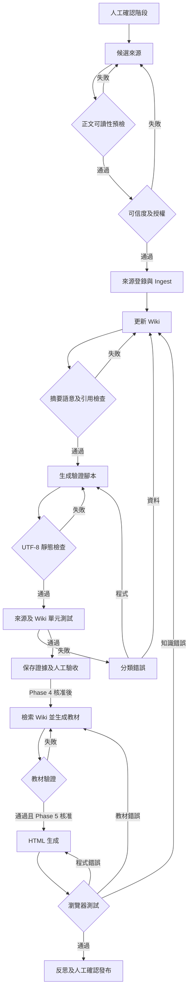
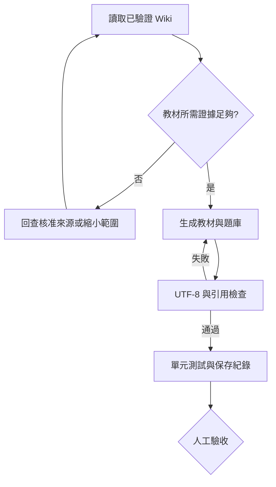

# Workflow Graph V2

依 ERR-001（正文 403）與 ERR-002（Windows CP950）改進。V1 保留。

每個修正迴圈最多三次自動重試，超限 BLOCKED；正常新增來源不計入。各階段需人工核准。

| 改進 | V1 | V2 | 執行狀態 |
|---|---|---|---|
| ERR-001 | 初步來源確認 | 候選階段正文可讀性預檢 | 規則已修訂；本次未新增來源，未重新驗證外網 |
| ERR-002 | 測試時發現編碼錯誤 | 程式生成後先做 UTF-8 靜態檢查 | Phase 3 執行，見 execution-log |

Phase 4 已執行 Wiki 檢索、缺口處理與教材驗證。Phase 5 已執行節點 O（HTML 生成）與 P（瀏覽器測試）：P→程式錯誤→O 迴圈實際觸發（ERR-004、ERR-005），另有前端驗證器自身錯誤（ERR-003）；未觸發知識或教材錯誤路徑。Graph 是否據此修訂留待 Phase 6 人工核准，V2 圖形本次未修改。此為 LLM 協作與 Python 檢查流程，不是自動 Graph 執行引擎。

## Phase 4 子流程（已執行一次）

本次依 M07 缺口回查 S009/S010；SL03 縮小範圍。迴圈失敗路徑以測試模擬驗證，並非實際教材生成失敗。
