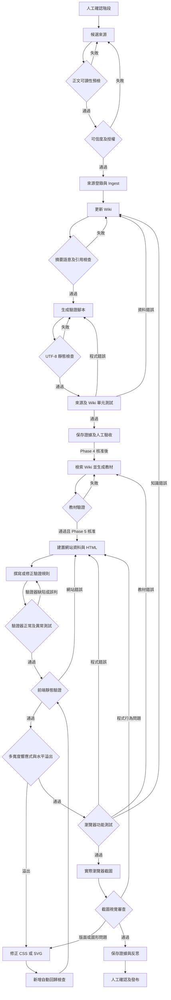

# Workflow Graph V3

依 Phase 5 實際錯誤 ERR-003～ERR-006 細化前端段落。V1、V2 保留為歷史版本，未修改。上游（來源、Wiki、教材）節點沿用 V2。

每個修正迴圈最多三次自動重試，超限 BLOCKED；各階段需人工核准。此為 LLM 協作＋Python／Node 檢查＋人工審查的流程，不是自動 Graph 執行引擎。

## V1 → V2 → V3 差異與證據

| 版本 | 變更 | 對應實際錯誤證據 |
|---|---|---|
| V1 | Phase 1 規劃：取得來源→Wiki→教材→HTML→瀏覽器測試→錯誤分類 | 無（規劃版） |
| V2 | 候選階段新增「正文可讀性預檢」 | ERR-001：S006 正文再次定位時 403 |
| V2 | 程式生成後、單元測試前新增「UTF-8 靜態檢查」 | ERR-002：Windows CP950 解碼 UTF-8，6 項測試 5 項 ERROR |
| V3 | 新增「撰寫或修正驗證規則」與「驗證器正常及異常測試」，驗證器缺陷或誤判返回規則修正，不修改網站 | ERR-003：驗證器首次執行 94/96（集合被汙染、佔位檔誤判），2 次修正；ERR-006：決策紀錄文字使資料檔被誤判，95/96 與 test_baseline FAIL，1 次修正 |
| V3 | 新增「多寬度響應式與水平溢出」，置於瀏覽器功能測試之前，溢出返回 CSS／SVG 修正 | ERR-004：首次瀏覽器測試 29/33，360／768／1024／1440px 共 4 項溢出 |
| V3 | 新增「實際瀏覽器截圖」與「截圖視覺審查」；版面或圖形問題返回 CSS／SVG，程式行為問題返回網站建置 | ERR-005：標題被覆蓋、SVG 文字裁切、色輪標籤裁切、標籤框過寬、截圖拍在淡入中途（只靠截圖發現）；首次載入 scrollY=58（程式行為，同樣由截圖發現） |
| V3 | 修正後先「新增自動回歸檢查」再回到前端靜態驗證 | ERR-005 修正後新增「fresh load and #SL06 load are not scrolled」檢查（34/34），其後新增 file:// 檢查（35/35） |

V3 的前移只依上述實際錯誤；未依推測新增節點。上游節點維持 V2，因 Phase 5／6 未發生知識或教材錯誤（瀏覽器測試的 P→F、P→M 路徑自 V2 保留，Phase 5 未實際觸發）。

## 執行狀態

- V3 **尚未**以完整流程從頭重跑。Phase 5 的實際執行順序是 V2 加上事後歸納的步驟；V3 是根據該紀錄整理出的流程。
- Phase 6 最終驗證實際執行了 V3 的前端段落：W（unittest 中的驗證器基準與反例測試）、S（validate_frontend）、R 與 P（瀏覽器測試內的多寬度溢出與功能檢查）、Q（截圖）、Y（LLM 檢視截圖）。上游節點 B–N 未重新執行（來源未重新擷取；Wiki 與教材未變更，只重跑其驗證腳本）。結果見 execution-log FIN-001。另以 pages-subpath-test.js 模擬 GitHub Pages 子路徑（非實際部署）。
- Phase 6 實際觸發一次 V3 迴圈：Y（視覺審查 Graph V3 截圖）→ X（修正 SVG 繪製）→ T（新增圖形重疊回歸檢查）→ S／P 重跑；見 ERR-007。該迴圈 3 次後 V1／V2 殘留標籤重疊標記 BLOCKED，因此 Z（保存證據）是在 BLOCKED 狀態下進行，待人工確認。
- R 在現行 browser-test.js 中仍與功能檢查同屬一個腳本；「先溢出、後功能」的先後順序目前是流程規範，腳本內尚未拆成獨立先行步驟。
